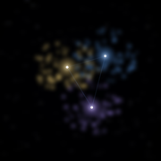
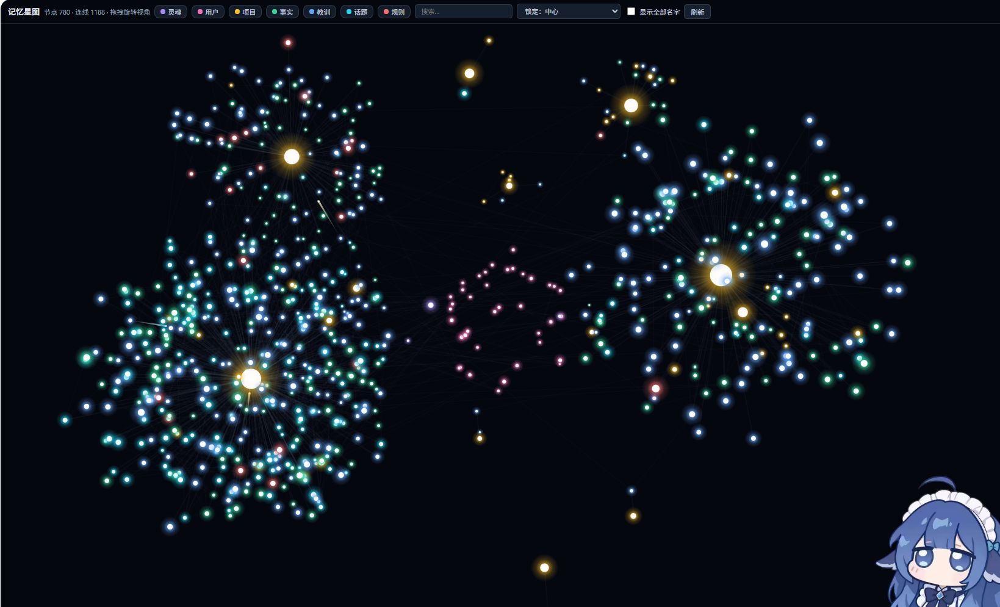

# meow-memory-starmap

Star-map panel for the [meow-memory](https://www.npmjs.com/package/meow-memory) store inside DeepSeek Harness: every memory entry is a glowing star, project memories gather around a galaxy core, edges follow project membership and shared keywords, and meteor trails run along the links.

Read-only. It opens the SQLite store with `node:sqlite` in read-only mode and never writes to it.





A workspace's memory store as a star map: each project is a galaxy with a yellow core, every memory entry is a glowing star, and the edges are project membership and shared keywords.

## What you see

| Element | Meaning |
| --- | --- |
| Star | one memory entry |
| Colour | memory level (soul / user / project / fact / lesson / topic / rules) |
| Size | `importance` |
| Halo | `status` |
| Galaxy core | a project, with its memories orbiting it |
| Edge | project membership, or two entries sharing keywords |
| Meteor | a pulse travelling along an edge; denser on the selected node |

Zooming out fades individual memories into their galaxies (level of detail), so a 1000-entry store stays readable. Names are hidden until you hover or select a node, and the toolbar has a "show all names" checkbox.

## Requirements

- DeepSeek Harness with the Web GUI (`0.2.2-rc.1` is what this release is tested against).
- [meow-memory](https://www.npmjs.com/package/meow-memory) installed in the same workspace — it owns the database this panel reads.
- Node.js 22.5 or newer (`node:sqlite`).

## Install

```sh
dsh plugin add meow-memory-starmap          # from npm
dsh plugin add github:HirschNo/meow-starmap # or straight from this repository
```

Restart DeepSeek Harness, then open **记忆星图** in the left sidebar.

## Where the data comes from

The panel reads `<workspace>/.dsh-meow/memory.db`, the store meow-memory maintains for the current workspace. Resolution order:

1. `DSH_MEOW_DB` — full path to a `memory.db`
2. `DSH_MEOW_WORKSPACE` / `DSH_WORKSPACE` — workspace root
3. the host process's current directory, walking up four levels

If none of them contains a database, the panel says so and lists the paths it tried.

## Levels

`soul` · `user` · `project` · `fact` · `lesson` · `topic` · `rules` — each level is one table in the store, and each gets its own colour in the map.

## Limitations

- Read-only: you cannot edit importance or status from the panel.
- No time axis: the map shows the current state, not how memories evolved.
- Keywords drive the second edge type, so entries without keywords only connect through their project.

## License

MIT
