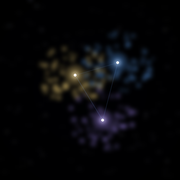

# meow-memory-starmap

把 [meow-memory](https://www.npmjs.com/package/meow-memory) 的记忆库画成星图的 DeepSeek Harness 面板：一条记忆是一颗发光的星，项目记忆聚在星系核周围，连线来自项目归属和关键词共现，选中节点时连线上有流星。

只读。用 `node:sqlite` 以只读模式打开数据库，绝不写库。



## 看到的是什么

| 元素 | 含义 |
| --- | --- |
| 星点 | 一条记忆 |
| 颜色 | 记忆层级（soul / user / project / fact / lesson / topic / rules） |
| 大小 | `importance` |
| 光晕 | `status` |
| 星系核 | 一个项目，它的记忆围绕它运行 |
| 连线 | 项目归属，或两条记忆共享关键词 |
| 流星 | 沿连线跑的亮点，选中的节点连线更密 |

缩远时记忆渐隐、项目放大成星系光团（LOD 聚合），上千条记忆也不会糊成一团。名字默认隐藏，悬停或选中才显示；工具栏有「显示全部名字」开关。

## 要求

- 带 Web GUI 的 DeepSeek Harness（本版本在 `0.2.2-rc.1` 上测试）。
- 同一工作区里装了 [meow-memory](https://www.npmjs.com/package/meow-memory)——它才是这份数据库的主人。
- Node.js 22.5 以上（需要 `node:sqlite`）。

## 安装

```sh
dsh plugin add meow-memory-starmap          # 从 npm 装
dsh plugin add github:HirschNo/meow-starmap # 或者直接从仓库装
```

重启 DeepSeek Harness，左侧栏出现 **记忆星图**。

## 数据从哪来

读 `<工作区>/.dsh-meow/memory.db`，也就是 meow-memory 为当前工作区维护的库。查找顺序：

1. `DSH_MEOW_DB` —— 直接给 `memory.db` 的完整路径
2. `DSH_MEOW_WORKSPACE` / `DSH_WORKSPACE` —— 工作区根目录
3. 宿主进程当前目录，向上找四层

都没有时，面板会说明找不到，并列出它试过的路径。

## 层级

`soul` · `user` · `project` · `fact` · `lesson` · `topic` · `rules`，一层对应库里一张表，各有一种颜色。

## 限制

- 只读：不能在面板里改 importance 或 status。
- 没有时间轴：画的是当前状态，不是记忆的演化过程。
- 第二类连线靠关键词，所以没有关键词的记忆只能通过项目归属连上。

## 许可

MIT
